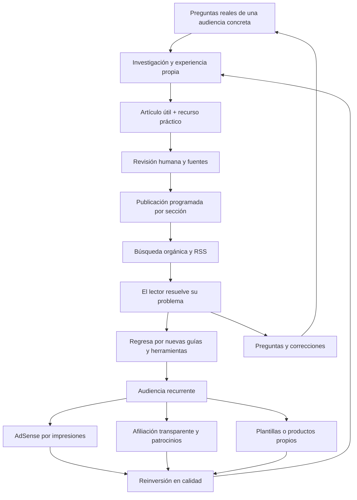

# Propuesta de negocio · Punto y Sigue

Marca provisional. La disponibilidad del nombre, sus marcas comerciales y dominios no se ha verificado. Investigación de políticas y proveedores: 8 de octubre de 2026.

## La idea

Un blog personal para lectores hispanohablantes que quieren resolver pequeñas tareas y aprovechar mejor su semana. Diferenciación: cada artículo responde una pregunta concreta, aporta un ejemplo propio y termina con una acción o recurso reutilizable.

La base admite tecnología, deporte y vida práctica, pero conviene comenzar con un área donde el autor tenga experiencia comprobable. Propuesta inicial: tecnología útil y organización personal; deporte como sección secundaria a validar. Evitar una mezcla de noticias genéricas que no comparte audiencia.

## Diagrama del negocio

## Cómo convertirse en una necesidad útil

No depender de publicar más. Crear un motivo concreto para volver:
- Tecnología: guías probadas y mantenidas con capturas propias; plantillas de automatización reutilizables.
- Vida práctica: planificador semanal y listas descargables que se usen de verdad.
- Deporte: listas de preparación y guías locales verificadas, sin copiar resultados ni contenido con derechos.
- A futuro: guardar recursos, suscripción voluntaria y un resumen semanal. No están conectados en esta base.

Validar con lectores antes de construir cuentas o herramientas complejas. Preguntar qué problema resolvieron, qué faltó y qué guardaron para reutilizar. Elegir la siguiente función según uso real.

## Automatización

Implementado: creación de borradores por CLI; revisión obligatoria; categorías; visibilidad según fecha; exclusión de demos en producción; sitemap y RSS dinámicos.

Flujo futuro con CMS/n8n: pregunta recibida → ficha editorial → borrador → comprobación de fuentes, derechos y ejemplos → aprobación humana → fecha de publicación → webhook de despliegue → RSS → distribución consentida → registro de resultados y errores. Usar identificador único para evitar duplicados, reintentos limitados y cola de fallos. No publicar automáticamente contenido extraído de otras webs.

No se han conectado servicios, claves, redes sociales ni correo. Para programar en la versión actual basta desplegar el archivo aprobado con su fecha futura; debe mantenerse un servidor dinámico.

## AdSense y rentabilidad

Google exige contenido original relevante y buena experiencia; el diseño por sí solo no garantiza aprobación. No hay en las fuentes citadas una regla universal de “20 artículos” ni una espera que garantice aprobar.

El negocio no debe basarse en conseguir clics: Google anunció el paso a pagos por impresión para editores. Medir ingreso por mil páginas vistas (RPM de página), sesiones de calidad y retorno. Nunca pedir clics, hacer autoclics o colocar elementos que los provoquen accidentalmente.

Modelo de escenario: ingresos estimados = páginas vistas / 1.000 × RPM de página observado.
Ejemplo hipotético, no previsión: 30.000 páginas vistas con RPM de US$2 producirían US$60; con US$5, US$150. El RPM real depende de audiencia, geografía, temática, demanda, visibilidad y temporada. Restar dominio, hosting, herramientas, creación de contenido e impuestos para estimar beneficio.

Ubicaciones preparadas: un espacio horizontal después de explorar temas y un lateral de lectura en pantallas grandes. Son reservas visuales; no cargan AdSense. Empezar con pocos anuncios, verificar móvil y medir experiencia antes de ampliar.

## Hoja de ruta

| Fase | Entrega | Señal para avanzar |
|---|---|---|
| Antes de lanzar | Dominio, autor real, contacto, políticas completas, artículos propios revisados, HTTPS | Todas las páginas útiles, indexables y sin texto de ejemplo |
| Primer mes | Un tema principal, ritmo editorial sostenible y recursos útiles | Lectores confirman que resolvieron un problema |
| Meses 2–3 | Mejorar consultas reales, enlaces internos y artículos existentes | Aumento de retornos y uso de recursos |
| Monetización | Solicitud AdSense, CMP aplicable, anuncios separados y medidos | Aprobación y tráfico válido; seguimiento de RPM y experiencia |
| Expansión | Afiliados declarados, colaboraciones y productos propios | Demanda comprobada y margen positivo |

Los tiempos son orientativos, no condiciones de Google ni promesas de tráfico.

## Métricas y decisiones

- Search Console: consultas, impresiones, clics y páginas indexadas; mejorar contenidos que responden parcialmente a una búsqueda.
- Analítica con privacidad adecuada: visitantes recurrentes y uso de recursos, sin inflar métricas con tráfico comprado.
- UX: carga, estabilidad visual, navegación con teclado y legibilidad móvil. Auditar Core Web Vitals después del despliegue real.
- Negocio: RPM de página, coste por artículo útil, coste mensual y margen. Comparar periodos equivalentes.
- Calidad: fuentes rotas, artículos desactualizados, correcciones y proporción de lectores que encuentran una respuesta.

## Dominio y proveedor

Propuestas sin disponibilidad confirmada: puntoysigueblog.com (coherente con esta marca), ideasconrumbo.com (más amplio), o tunombre.com (mejor si el proyecto gira alrededor de tu reputación personal). Evitar guiones, números y nombres difíciles de dictar. Verificar disponibilidad y marcas antes de pagar.

Preferencia: .com para audiencia hispanohablante amplia. Un dominio local tiene sentido si el servicio y el contenido se concentran en un país, no por una supuesta garantía de mejores ingresos.

| Proveedor | Cuándo elegirlo | Qué comparar |
|---|---|---|
| Cloudflare Registrar | Buscas registro/renovación a coste del registro y aceptas su DNS | Coste final, impuestos y obligación de usar nameservers Cloudflare |
| Porkbun | Quieres comparar una alternativa con precios publicados de registro y renovación | Coste total a 3 años, renovación, privacidad y extras |

No se afirma un ganador universal ni un precio exacto: comparar en el carrito el mismo dominio no premium y la misma duración. Coste de 3 años = alta + 2 renovaciones + impuestos + extras necesarios. El alojamiento y el buzón de correo son servicios separados. No comprar solo por una promoción del primer año.

## Fuentes oficiales

- Preparación para AdSense: https://support.google.com/adsense/answer/7299563
- Problemas de aprobación: https://support.google.com/adsense/answer/12176698
- Políticas del programa y clics: https://support.google.com/adsense/answer/48182
- Ubicación de anuncios: https://support.google.com/adsense/answer/1346295
- Pago por impresión: https://support.google.com/adsense/answer/14129646
- Consentimiento EEE, Reino Unido y Suiza: https://support.google.com/adsense/answer/13554116
- Contenido automatizado a escala y spam: https://developers.google.com/search/docs/essentials/spam-policies
- Cloudflare, precios sin margen: https://www.cloudflare.com/application-services/solutions/low-cost-domain-names/
- Cloudflare, tabla de precios: https://pricing.registrar.cloudflare.com/
- Cloudflare, requisito DNS: https://developers.cloudflare.com/dns/nameservers/nameserver-options/
- Porkbun, precios: https://porkbun.com/products/domains
- Porkbun, comparador de coste: https://porkbun.com/about/domain-cost-calculator
